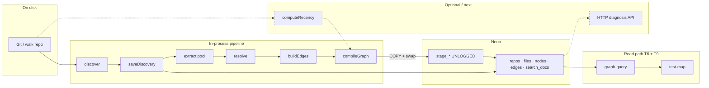
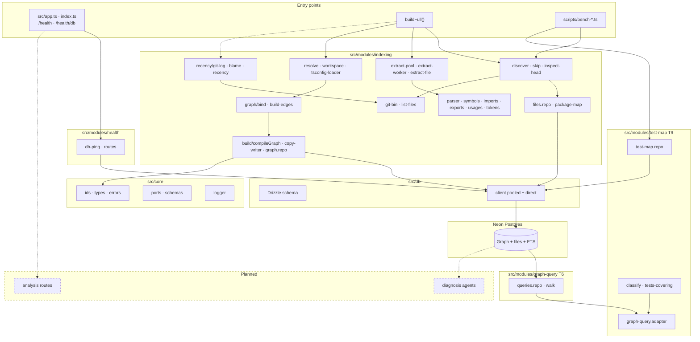

# GateKeeper

GateKeeper indexes a JavaScript/TypeScript repository into a **dependency graph** stored in Postgres (Neon). From a vague bug report it will rank likely causes, verify them with probes in a git worktree, and suggest a fix—**without editing the user’s code**.

**Where we are now:** **Indexing, Neon persist, graph queries, and test-map (T9-lite)** are done in-process. **Not started:** diagnosis API, watcher, LLM agents (analysis routes are stubs). **Partial:** git recency module exists but is **not** wired into `buildFull`.

### Completion snapshot

| Phase | Status | Notes |
|-------|--------|--------|
| **Index pipeline** (T1–T3) | **Done** | Discover → extract → resolve → edges |
| **Persist to Neon** (T5) | **Done** | `buildFull`, stage COPY, swap, FTS |
| **Graph read API** (T6) | **Done** | SQL repos + BFS; `bench:queries` on cal.com |
| **Git / ops** (T1-harden, T4, T5-fix) | **Mostly done** | Recency **not** in build; T5-crash on Windows DB tests |
| **Test map** (T9-lite) | **Done** | Classify tests, reverse-walk coverage, cal.com validated |
| **Product diagnosis** (T7+) | **0%** | HTTP query API, probes, ranking — backlog |

Roughly **~70%** of the “graph in DB + query + test intelligence” platform; **~0%** of the end-user diagnosis product beyond health checks.

> **New chat / lost session?** Read [**Project context (handoff)**](#project-context-handoff) below and [`.cursor/rules/gatekeeper.mdc`](.cursor/rules/gatekeeper.mdc). Agents must not edit user app code—only this repo.

---

## Project context (handoff)

Use this block to brief a fresh assistant.

### Goal

Build an AST-backed **dependency graph** of a JS/TS repo in **Neon**, then (later) diagnose bugs from vague reports using **graph-derived candidates only** (no free-form symbol invention), verify with probes, suggest fixes—never patch the user’s product code from GateKeeper itself.

### Architecture rules (non-negotiable)

- `src/core` imports only **zod, pino, Node built-ins**.
- **SQL only** in `*.repo.ts`.
- Repo paths are **POSIX**, **repo-relative**; node IDs from `src/core/ids.ts`.
- tree-sitter trees stay inside parse functions; only **facts** leave.
- Traversal uses `walk()` in `parser.ts`—no recursive `node.children` over whole trees.

### What is already built

1. **Discovery** — `git` file list or directory walk; `mode`, `walkReason`; `git-bin.ts` resolves Windows `git.exe`.
2. **Extract (T1–T2)** — tree-sitter: symbols, imports/exports, usages (calls, refs, JSX), `tokenize`, `extractFile`; Piscina pool with safe `close()` (`T5-fix`).
3. **Resolve + graph (T3)** — workspace/tsconfig resolution; `buildEdges` / bind: `calls`, `refs`, `flows_into`, imports, hooks, barrels; `in_degree`.
4. **Persist (T5)** — `compileGraph` → COPY into `stage_*` → advisory lock → swap into `nodes`, `edges`, `search_docs`; bump `graph_version`; **determinism hash** (MD5 over sorted ids + edges).
5. **Recency (T4, module only)** — `computeRecency` (file `git log`, optional lazy `blameSymbols`); run via `bench:recency`; **not** called from `buildFull` yet.
6. **Graph queries (T6)** — `dependents`, `dependencies`, BFS `walk`, shortest `path`, `findByName`; SQL in `queries.repo.ts`, BFS in `walk.ts`; migration `0004_query_indexes.sql` (covering edge indexes + name `text_pattern_ops`).
7. **Test map (T9-lite)** — `classify.ts` (path rules), `testsCovering` (reverse dependents at depth 5 default), `graph-query.adapter.ts` (`testsCoveringNode`), `test-map.repo.ts` (SQL for bench); **`pnpm bench:testmap`**.
8. **Cal.com in Neon** — `pnpm bench:build bench/cal.com --repo-id calcom` → ~5k files, ~105k edges; use `calcom` for query/testmap benches.

### Data in Neon

| Table | Purpose |
|-------|---------|
| `repos` | id, root, name, `graph_version` |
| `files` | discovery rows per path |
| `nodes` | symbols, files, folders, externals; `in_degree`, export flags |
| `edges` | typed edges with `path`, `line`, optional `meta` |
| `search_docs` | FTS from tokenized name/path at swap |
| `stage_*` | UNLOGGED bulk load; cleared after swap |

### Key entry points

| Entry | Location |
|-------|----------|
| Full index + DB | `buildFull()` — `src/modules/indexing/build/build-full.ts` |
| Graph reads | `src/modules/graph-query/queries.repo.ts`, `walk.ts` |
| Tests covering a symbol | `testsCoveringNode()` — `src/modules/test-map/graph-query.adapter.ts` |
| HTTP | `src/app.ts` — `/health`, `/health/db` only (product diagnosis TBD) |

### Fixtures & scale targets

- **`fixtures/sample-js`** (11 files) — planted graph: 3 `calls` into `utils/string.js#titleCase`, `flows_into` from `config.js#DISCOUNT_RATE` → `pricing.js#applyDiscount`, barrel via `utils/index.js`.
- **`bench/cal.com`** (gitignored clone) — ~5k files, ~105k edges in-memory; `pnpm bench:build bench/cal.com` persists to Neon (use `--repo-id` to query later).

### Tests & known pain

- **`pnpm test`** — 174 unit tests (`vitest.config.ts`: **serial files** on Windows).
- **`pnpm test:db`** — Neon: `files.repo`, `build-full`, `graph-query` (needs `TEST_DATABASE_URL` + `pnpm db:migrate:test`).
- **T5-crash (open):** `build-full.repo.test.ts` can **0xC0000005** even with serial files; see [`docs/BOARD.md`](docs/BOARD.md). Workaround: run DB test files **one at a time**, not always full `test:db` in one vitest run.

### Not done yet (backlog)

- Wire **T4 recency** into `buildFull` / node `last_change_*`.
- **`bench:build --cleanup` FK order** — delete `files` before `repos` (or CASCADE) so cleanup does not fail on FK.
- **HTTP API** for index + graph query.
- **Watcher** / incremental index.
- **Diagnosis** pipeline (agents, worktree probes, ranked causes).

### Migrations

`drizzle/0000_init.sql` … `0003_stage_search.sql`, **`0004_query_indexes.sql`**. Apply with `pnpm db:migrate` (direct URL, not pooler).

---

## What is done (tickets)

| Ticket | Status | Deliverable |
|--------|--------|----------------|
| **T1** | Done | `FileFacts`: symbols, imports/exports, calls, refs, JSX, `tokenize`, `extractFile` |
| **T1-harden** | Done | `git-bin.ts` — `resolveGitBin()`; discovery `mode` + `walkReason` |
| **T2** | Done | Piscina **extract pool**, timeouts |
| **T3** | Done | Import **resolve**, **buildEdges** (calls, refs, `flows_into`, binding stats) |
| **T4** | Module done | `computeRecency`, `blameSymbols`; **not** in `buildFull` |
| **T4-fix** | Done | 2000-commit log, boundary/root, file-level default blame |
| **T5** | Done | COPY → stage → swap, `search_docs`, determinism hash |
| **T5-keep** | Done | `bench:build` keeps graph; `--cleanup`, `--repo-id`, DB ping |
| **T5-fix** | Done | Pool `close()` / drain; `stress:pool` |
| **T6** | Done | Graph queries + `bench:queries` + covering indexes |
| **T9-lite** | Done | `classifyTestFile`, `testsCovering`, T6 adapter, `bench:testmap` (cal.com: 99.6% link health, p95 573 ms, 36.5% symbols covered at depth 5) |
| **T7+** | Planned | Query HTTP API, wire recency, watcher, diagnosis |

---

## Pipeline flow (data path)

Solid = implemented. Dashed = planned.



---

## High-level design (components)



| Component | Responsibility |
|-----------|----------------|
| **git-bin** | Resolve `git.exe` once; all git subprocesses use absolute path |
| **discover** | `mode: git \| walk`, file list + lang + package/tsconfig context |
| **extract pool** | Parallel tree-sitter in workers; facts only leave workers |
| **graph** | Bind call sites; emit typed edges + `in_degree` |
| **build** | Stage CSV COPY, advisory lock, swap, `graph_version`, MD5 hash |
| **graph-query** | SQL neighbors + TS BFS `walk` / `path`; `findByName` with barrel deprioritization |
| **test-map** | Classify test/e2e/support paths; reverse-walk to tests covering a symbol (`DEFAULTS.maxDepth = 5`) |
| **recency** | One-pass `git log` for files; `blameSymbols` on demand |
| **core** | No DB/parser imports—IDs and contracts |

---

## Benchmarks & quality (reference)

| Target | Result |
|--------|--------|
| `fixtures/sample-js` | 11 files; Neon `buildFull` + graph-query tests |
| cal.com | ~5k files, ~105k edges (in-memory `bench:graph`) |
| cal.com extract | Matches `extract-baseline-v3.json` |
| **Tests** | **174** unit + DB tests (graph-query, test-map; run files separately on Windows) |
| **stress:pool** | 0/50 child-process crashes |
| cal.com **buildFull** | `pnpm bench:build bench/cal.com` → `discoveryMode`, `graphHash`, timings |
| cal.com **queries** | `pnpm bench:queries calcom` (index scans, &lt;50 ms execution gates) |
| cal.com **testmap** | 449 unit / 66 e2e / 151 support file nodes; **99.6%** test→product edges; **36.5%** symbols with static test link @ depth 5 (see DECISIONS: uncovered ≠ innocent) |
| cal.com **kept graph** | `repo_id=calcom` after `pnpm bench:build bench/cal.com --repo-id calcom` |

---

## Stack

Node 22 · TypeScript (strict ESM) · Express 5 · Neon + Drizzle + `pg-copy-streams` · tree-sitter · Piscina · Vitest · Biome

---

## Commands

| Command | Purpose |
|---------|---------|
| `pnpm test` | Unit tests (174) |
| `pnpm test:db` | Neon integration (see BOARD if build-full flakes on Windows) |
| `pnpm test:all` | Both |
| `pnpm bench:build <root> [--repo-id] [--cleanup]` | Full persist; keeps graph by default |
| `pnpm bench:queries <repoId>` | Query latency + EXPLAIN gates on stored graph |
| `pnpm bench:testmap <repoId> [--depths 2,3,4]` | Test classification, link health, covering lookups |
| `pnpm bench:recency <root>` | File recency % + blame sample |
| `pnpm bench:parse` / `bench:graph` / `bench:resolve` / `stress:pool` | Stage benchmarks |
| `pnpm db:migrate` / `db:migrate:test` | SQL migrations (`scripts/run-migrations.ts`) |

---

## Setup

```powershell
pnpm install
pnpm run setup
```

`.env`: `DATABASE_URL` (pooled), `DATABASE_URL_DIRECT` (no `-pooler`), `TEST_DATABASE_URL` (+ optional `TEST_DATABASE_URL_DIRECT`).

```powershell
pnpm db:migrate
pnpm db:migrate:test
```

`bench/cal.com` is **gitignored** — clone under `bench/` locally.

---

## Docs

| Doc | Contents |
|-----|----------|
| [`docs/DECISIONS.md`](docs/DECISIONS.md) | Serial Vitest; test-map coverage semantics (T12) |
| [`docs/BOARD.md`](docs/BOARD.md) | Open issues (e.g. T5-crash) |
| [`.cursor/rules/gatekeeper.mdc`](.cursor/rules/gatekeeper.mdc) | Agent working rules for this repo |

---

## License

ISC (see `package.json`).